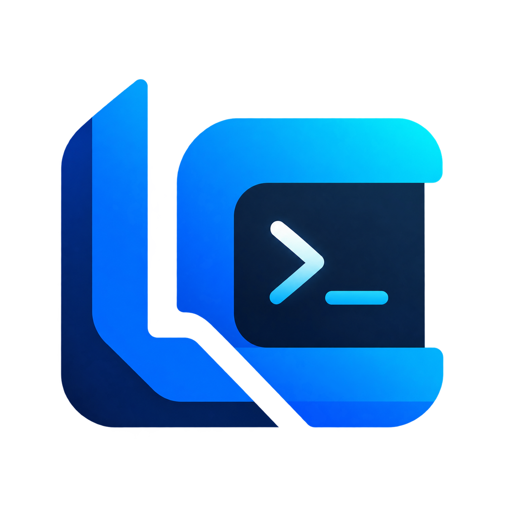

# Local Commander V8.1 Portable

Local Commander connects ChatGPT to an authorized Windows computer through a hosted relay while keeping local permissions authoritative.

Local Commander V8.1 keeps ChatGPT as the intelligence layer and turns the local
computer into a stronger execution environment. No local LLM and no local API key
are required.

## Two modes

### Tool Mode
Direct actions such as reading files, running commands, using Git, browser
automation, screenshots, mouse/keyboard and clipboard.

### Agent Mode
ChatGPT can create a task and keep local task state across multiple steps:
plan/context, checkpoints, pause/resume, validation notes and a final summary.
The local Agent Mode does **not** invent plans with its own model. ChatGPT remains
the planner.

## New in V8.1

- Persistent terminal sessions:
  - `lc_terminal_start`
  - `lc_terminal_send`
  - `lc_terminal_read`
  - `lc_terminal_stop`
- Clipboard:
  - `lc_clipboard_read`
  - `lc_clipboard_write`
- Bounded binary transfer:
  - `lc_binary_read`
  - `lc_binary_write`
- Agent task state:
  - `lc_task_start`
  - `lc_task_status`
  - `lc_task_step`
  - `lc_task_pause`
  - `lc_task_resume`
  - `lc_task_cancel`
  - `lc_task_checkpoint`
  - `lc_task_complete`
- Browser snapshots now include a structured inventory of links, buttons and inputs.
- Dashboard shows Agent Mode state and persistent terminal count.
- Existing V8 features remain available.

## Installation

1. Extract the ZIP.
2. Run `LocalCommander-V8.1.bat`.
3. On first run, the portable Python runtime and optional Chromium are prepared
   inside the Local Commander folder.
4. Complete pairing in the browser.
5. Connect the Local Commander plugin in ChatGPT.

Only `LocalCommander-V8.1.bat` is included. Older V8 launchers are intentionally not bundled.

## Important compatibility note

The V8.1 local agent already implements the new actions, but the ChatGPT Local
Commander plugin/connector must also expose the new tool names before ChatGPT can
invoke them directly. Existing V8 actions continue working with the current plugin.

## Security

The same local path profile remains in force. Binary reads/writes and task
workspaces are routed through the existing path authorization layer. Credentials
remain protected locally with Windows DPAPI.

The task checkpoint stores metadata, Git HEAD/status and a bounded diff. It does
not silently create commits or reset the workspace.

See `docs/conectar.html` for the full connection guide.

## Dashboard behavior

After first-run setup reaches `[6/6]`, the browser may open the connection/help page.
That is expected, but the Local Commander terminal must remain open and show the
V8.1 dashboard while the agent is running.

If the Python agent exits unexpectedly, the launcher now keeps the terminal open,
shows the exit code, and writes diagnostic logs to `runtime/logs/` instead of
silently closing the window.

## Download / release asset

For end users, publish `LocalCommander-V8.1-Portable.zip` as the GitHub Release asset. The repository itself should contain source/docs only; the portable Python runtime and Playwright browser are downloaded on first run.

## ChatGPT plugin

The private Local Commander plugin currently uses the same hosted relay. Plugin page:
`https://chatgpt.com/plugins/plugins_6acd2b0fb8a48191b53aaf4c28044e1a`
